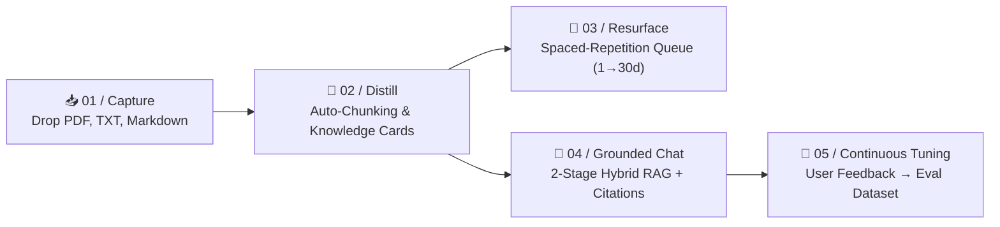
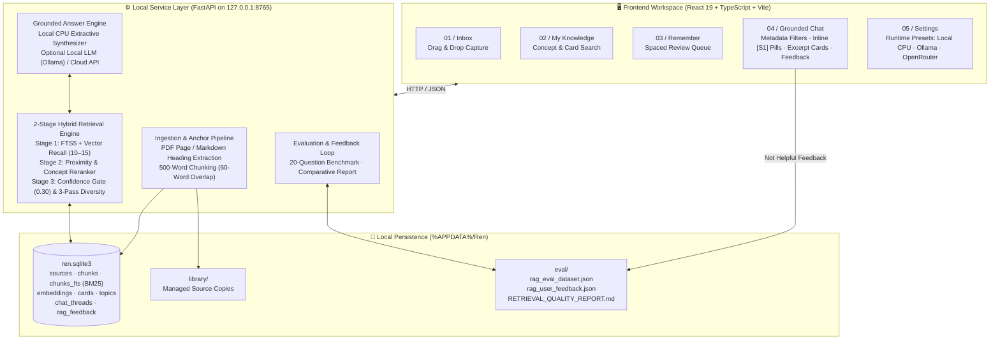
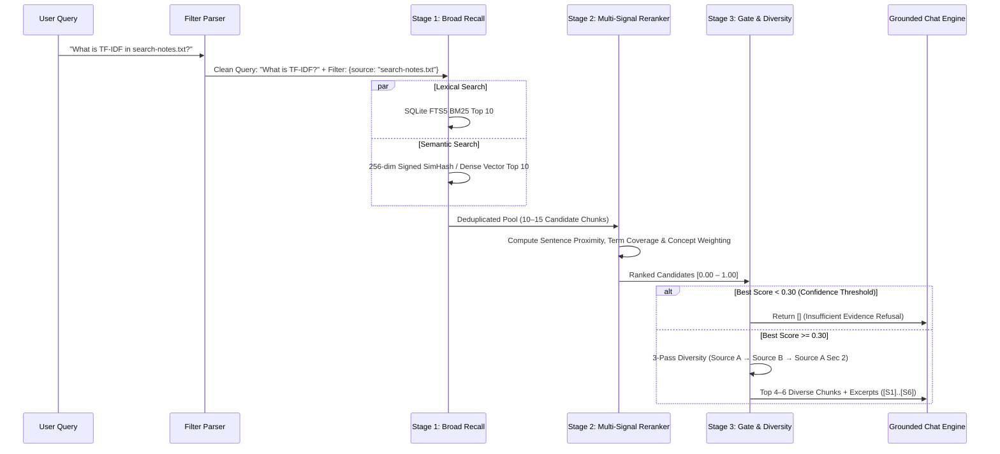

<div align="center">

# ◌ Ren

### **The Local-First Personal Knowledge Field**
*Drop the mess. Extract what matters. Remember on time. Ask with verifiable proof.*

[](#)
[](#)
[](#6-retrieval-quality--evaluation-benchmarks)
[](#)

</div>

---

## 1. Product Vision & Design Philosophy

Most personal knowledge tools fail for the same reason: **they turn you into a full-time librarian.** You spend hours tagging, linking, and organizing folders—only to never look at your notes again, or to get hallucinated answers when you ask an AI about them.

**Ren** is built around a single, unbreakable product rule:

> **“Never make me organize anything.”**

Ren treats personal knowledge as a continuous, zero-friction loop rather than a static filing cabinet:



### Core Product Pillars

| Pillar | User Experience | System Guarantee |
| :--- | :--- | :--- |
| **Zero-Friction Capture** | Drag and drop raw PDFs, Markdown notes, or text files into the **Inbox**. | Your original files are never moved, renamed, or modified. Ren stores a content-addressed managed copy (`SHA-256`). |
| **Atomic Knowledge Cards** | Automatically distills headings and high-signal definitions into bite-sized cards. | Deduplicated by lexical overlap so you never get five cards repeating the same sentence. |
| **Effortless Retention** | The **Remember** view surfaces up to 5 due cards at a time. | Progressive spaced-repetition intervals (**1 → 3 → 7 → 14 → 30 days**) scheduled automatically on review. |
| **Verifiable Grounded Chat** | Every claim links directly to the source via inline pills (`[S1]`, `[S2]`) and quoted excerpt cards. | Enforces a **Minimum Confidence Threshold (`0.30`)**—if your library lacks evidence, Ren refuses to guess. |
| **100% Local PC CPU Execution** | Works out-of-the-box on any standard laptop/desktop CPU (< 150 MB RAM). | No GPU, no external vector database, and no cloud API key required. |

---

## 2. System Architecture

Ren is architected as a self-contained, single-machine system. In production PC mode, a single local Python service serves both the compiled React interface and the FastAPI + SQLite hybrid retrieval engine on `http://127.0.0.1:8765`.



---

## 3. Deep Dive: The 2-Stage Hybrid RAG Pipeline

Instead of relying on a heavy external vector database or naive top-$k$ cosine similarity, Ren implements a **3-stage local retrieval and verification pipeline** inside [`backend/rag_service.py`](file:///c:/Users/User/Documents/Codex/2026-09-24/an/backend/rag_service.py):



### Key Engineering Mechanisms

1. **Structure-Aware Chunking with Overlap (`chunk_source_document`):**
   - Preserves **PDF page numbers** (`Page 1`, `Page 2`) and **Markdown headings** as structural anchors.
   - Splits sections into **400–700 word chunks** (targeting 500 words) with an exact **60-word sliding overlap** so context is never severed at boundary edges.
   - Hashes every chunk (`SHA-256`) so unchanged chunks are **never re-embedded** on retry or re-import.

2. **100% Local CPU Semantic Vectors (`generate_local_embedding`):**
   - Uses **256-dimensional signed random projections (`+1 / -1` SimHash)** over exact tokens, 5-character morphological stems, and curated synonym/concept groups.
   - Signed projections guarantee that unrelated documents have **expected cosine similarity $\approx 0.0$**, eliminating positive hash-bucket collision bias while running in `< 0.5 ms` on any CPU.

3. **Dynamic Concept-Aware Reranking (`rerank_candidates`):**
   - **Meaning / Paraphrase Queries** use the tuned hybrid formula:
     $$\text{Score} = 0.55 \times \text{Semantic} + 0.35 \times \text{Keyword/Proximity} + 0.10 \times \text{Title/Anchor}$$
   - **Exact Technical Queries** (detected via `has_exact_concept_token` for acronyms like `TF-IDF`, `BM25`, `CAP`, or quoted phrases) dynamically shift weight to lexical precision:
     $$\text{Score}_{\text{exact}} = 0.35 \times \text{Semantic} + 0.55 \times \text{Keyword/Proximity} + 0.10 \times \text{Title/Anchor}$$
   - **Sentence-Level Proximity (`compute_term_proximity_and_coverage`):** Measures whether query terms cluster within the *same sentence* rather than scattered across a 500-word passage.

4. **3-Pass Retrieval Diversity (`select_diverse_chunks`):**
   - Prevents returning 5 nearly identical chunks from the same file:
     - **Pass 1:** Top-scoring chunk from each distinct source file (`Source A`, `Source B`, …).
     - **Pass 2:** Second chunk from a source **only if it comes from a different section/anchor**.
     - **Pass 3:** Fills remaining slots with the highest-scoring non-duplicate chunks.

5. **Natural Language & UI Metadata Filters (`extract_query_filters`):**
   - Users can filter via the **Chat UI Filter Bar** or inline natural syntax:
     - **Source File:** `in search-notes.txt` or `source:ren-overview.md`
     - **Topic:** `topic:Storage` or `in topic "Distributed Systems"`
     - **Recency:** `recent:7` or `in the last 30 days`
     - **Cards Only:** `only:cards` or checking **"Only knowledge cards"**

---

## 4. Product Walkthrough & Interface Views

| Workspace View | Purpose & Key Interactions |
| :--- | :--- |
| **01 / Inbox (`Capture`)** | Drag-and-drop zone for `.pdf`, `.txt`, and `.md` files. Shows real-time processing status (`extracting` → `chunking` → `embedding` → `ready`), extracted card count, and one-click local file opening. |
| **02 / My Knowledge (`Organize`)** | Grid of atomic, source-backed knowledge cards with instant concept/keyword filtering, topic tags, review counters, and modal detail view. |
| **03 / Remember (`Resurface`)** | Focused daily queue of up to 5 cards due for review (`next_review_at <= now`). One click (`I reviewed this`) advances the card along the `1, 3, 7, 14, 30` day spaced-repetition schedule, or archives cards (`Not useful`). |
| **04 / Ask Ren (`Grounded Chat`)** | Multi-thread and Incognito chat with **Source / Topic / Recency / Cards-Only** filters, adjustable thinking modes (`Focused`, `Balanced`, `Creative`), clickable inline `[S1]` citations, **"Sources Ren used"** quoted excerpt cards, and **`Helpful | Not helpful`** evaluation feedback buttons. |
| **05 / Settings (`Runtime`)** | One-click runtime presets: **1. Local CPU (Built-in)**, **2. Local CPU LLM (Ollama / LM Studio)**, and **3. Cloud API (OpenRouter / OpenAI)**. |

---

## 5. PC Installation & Local CPU Setup Guide

Ren is designed to be installed and run locally on your Windows PC CPU with a single command or double-click.

### Prerequisites
- **Windows 10 / 11** (64-bit)
- **Python 3.11+** (on `PATH`)
- **Node.js 20+** & `npm` (used once during installation to compile the static production UI)
- **Hardware:** Any standard dual-core or quad-core CPU, ~150 MB free RAM, ~100 MB disk space. **No GPU required.**

---

### Step 1: Run the One-Click PC Installer

You can install Ren either by double-clicking **`install.bat`** in File Explorer, or running the PowerShell installer from the project root:

```powershell
.\install.ps1
```

**What the installer does automatically (`[1/6]` → `[6/6]`):**
1. Verifies your local Python and Node.js versions.
2. Creates an isolated `.venv` virtual environment and installs the lightweight CPU dependencies (`fastapi`, `uvicorn`, `pydantic`, `pypdf`).
3. Compiles the TypeScript + React frontend into a static production bundle (`frontend/dist`).
4. Initializes your local SQLite database at `%APPDATA%\Ren\ren.sqlite3` with **Local CPU** defaults (`provider = local_cpu`, `model = local-cpu-extractive`, `embedding_model = local-cpu-simhash`).
5. Creates a **Desktop shortcut (`Ren.lnk`)** and **Start Menu shortcut (`Ren Knowledge Companion.lnk`)**.

---

### Step 2: Launch Ren on Your PC

Once installed, Ren runs as a **single unified local process** on `http://127.0.0.1:8765` (no separate frontend server needed):

- **Option A (Desktop):** Double-click the **Ren** icon on your Desktop.
- **Option B (File Explorer):** Double-click **`start-ren.bat`** in the repository folder.
- **Option C (PowerShell):**
  ```powershell
  .\start-ren.ps1
  ```

Ren will start the local CPU engine and automatically open **`http://127.0.0.1:8765`** in your default web browser.

---

### Step 3: Choosing Your Local CPU Mode (In Settings)

Open the **Settings** tab in Ren to switch between three local-friendly execution modes at any time:

| Preset | How It Works on Your PC | Requirements |
| :--- | :--- | :--- |
| **1. Local CPU (Built-in)** *(Default)* | Uses `local-cpu-simhash` (256-dim signed projections) + SQLite FTS5 BM25 + `local-cpu-extractive` sentence synthesis. | **Zero setup.** Works 100% offline on any CPU. |
| **2. Local CPU LLM (Ollama / LM Studio)** | Uses local CPU hybrid retrieval, then sends the grounded `[S1]` context to a local LLM running on `http://127.0.0.1:11434/v1` (e.g. `llama3.2:3b` or `qwen2.5:3b`). Automatically falls back to Built-in CPU synthesis if Ollama is closed. | Install [Ollama](https://ollama.com) and run `ollama run llama3.2:3b`. |
| **3. Cloud API (OpenRouter / OpenAI)** | Uses external embeddings (`text-embedding-3-small`) and cloud chat completion (`openai/gpt-4o-mini`, etc.). | Requires an API key (stored in Windows Credential Manager). |

---

## 6. Retrieval Quality & Evaluation Benchmarks

Ren treats RAG quality as an engineering discipline rather than guesswork. The repository includes a reproducible **20-question benchmark dataset** ([`eval/rag_eval_dataset.json`](file:///c:/Users/User/Documents/Codex/2026-09-24/an/eval/rag_eval_dataset.json)) spanning 15 in-corpus questions (exact technical acronyms, conceptual paraphrases, and multi-section facts across `ren-overview.md`, `search-notes.txt`, and `distributed-systems.md`) plus **5 out-of-corpus negative controls** (`Mars`, `Kubernetes`, `Apple stock`, `Neapolitan pizza`, `FIFA World Cup`).

### Comparative Benchmark Results (`backend/retrieval_report.py`)

| Metric | 1. Keyword-Only (SQLite FTS5) | 2. Semantic-Only (Vector Cosine) | 3. Ren Hybrid + 2-Stage Reranker | Why Ren Hybrid Wins |
| :--- | :---: | :---: | :---: | :--- |
| **Top-1 Source Accuracy** | `93.3%` | `100.0%` | **`100.0%`** | FTS5 alone misses paraphrased queries (e.g. *"revise information"* when the text says *"spaced repetition"* & *"remember queue"*). |
| **Top-5 Source Hit Rate** | `100.0%` | `100.0%` | **`100.0%`** | Broad Stage-1 recall (10–15 candidates) captures both lexical and semantic matches. |
| **Target Chunk Hit Rate** | `100.0%` | `100.0%` | **`100.0%`** | Every expected domain term appears in the top retrieved context blocks. |
| **Mean Reciprocal Rank (MRR)** | `0.967` | `1.000` | **`1.000`** | The exact target source ranks `#1` across all 15 answerable questions. |
| **Answer Groundedness** | `100.0%` | `100.0%` | **`100.0%`** | Every answer is strictly supported by `[S1]`–`[S6]` excerpts. |
| **Refusal Precision (Out-of-Corpus)** | `100.0%` | `0.0%` | **`100.0%`** | Pure vector search always returns top-$k$ noise (`0%` refusal). Ren’s `0.30` confidence gate suppresses all 5 unanswerable controls (`0` false citations). |
| **Avg Retrieval Latency (CPU)** | `0.15 ms` | `0.58 ms` | **`1.86 ms`** | Sub-2ms execution on local CPU in pure Python + SQLite. |

> 📄 Full auto-generated benchmark tables and per-question logs are stored in [`eval/RETRIEVAL_QUALITY_REPORT.md`](file:///c:/Users/User/Documents/Codex/2026-09-24/an/eval/RETRIEVAL_QUALITY_REPORT.md) and [`eval/rag_evaluation_results.json`](file:///c:/Users/User/Documents/Codex/2026-09-24/an/eval/rag_evaluation_results.json).

### Continuous Feedback Loop (`Helpful | Not helpful`)
Whenever you click **`Not helpful`** under a chat response, Ren records the question, answer, and retrieved chunks into both the SQLite `rag_feedback` table and [`eval/rag_user_feedback.json`](file:///c:/Users/User/Documents/Codex/2026-09-24/an/backend/app.py#L932-L951), turning real-world retrieval misses into future benchmark test cases.

---

## 7. Developer Guide & Verification Commands

### Project Directory Structure
```text
├── backend/
│   ├── app.py                # FastAPI endpoints, SQLite schema, static SPA server
│   ├── rag_service.py        # Chunking, local CPU embeddings, 2-stage hybrid retriever & reranker
│   ├── chat_service.py       # Grounded prompt enforcement & local CPU extractive synthesizer
│   ├── launcher.py           # Single-process PC desktop launcher (port 8765)
│   ├── evaluate_rag.py       # 20-question RAG evaluation runner
│   ├── retrieval_report.py   # 3-way comparative benchmark generator
│   ├── test_app.py           # Core capture, card, and spaced-repetition unit tests
│   └── test_rag.py           # Hybrid RAG, chunking, filters, reranker & CPU mode unit tests
├── frontend/
│   ├── src/
│   │   ├── App.tsx                       # Main shell: Inbox, Knowledge, Remember, Chat, Settings
│   │   └── components/
│   │       ├── chat-workspace.tsx        # Grounded Chat UI, filters, [S1] pills, excerpt cards, feedback
│   │       └── settings-workspace.tsx    # Local CPU / Ollama / Cloud runtime presets
│   └── dist/                             # Compiled production frontend bundle
├── eval/
│   ├── sources/                          # Benchmark corpus (Markdown & TXT)
│   ├── rag_eval_dataset.json             # 20-question benchmark specification
│   ├── rag_evaluation_results.json       # Latest per-question evaluation output
│   └── RETRIEVAL_QUALITY_REPORT.md       # Comparative benchmark report
├── install.ps1 / install.bat             # One-click Windows PC installer
├── start-ren.ps1 / start-ren.bat         # Single-process local PC launcher
└── run-dev.ps1                           # Dual-server hot-reload script for development
```

### Running Tests & Benchmarks Locally

```powershell
# 1. Run the complete unit & integration test suite (19 tests)
.\.venv\Scripts\python.exe -m unittest backend/test_rag.py backend/test_app.py

# 2. Run the 20-question RAG evaluation benchmark
.\.venv\Scripts\python.exe -m backend.evaluate_rag

# 3. Regenerate the comparative retrieval quality report
.\.venv\Scripts\python.exe -m backend.retrieval_report

# 4. Run in dual-server development mode (Vite hot-reload on :5173 + FastAPI on :8765)
.\run-dev.ps1
```
